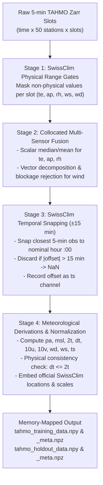

# Implementation Plan: Adopting SwissClim QC Standards for TAHMO Dataset Pipeline

## 1. Goal Description

This plan defines the end-to-end strategy for adopting the official **SwissClim Quality Control (QC) standard** (documented in [`weather-station-pipeline/docs/PIPELINE_DETAILS.md`](./PIPELINE_DETAILS.md)) to process raw 5-minute multi-sensor TAHMO observations (`tahmo_lazy.zarr`) into the ML-ready dataset for fine-tuning the ESFM foundation model (`ESFM_s_nm_e11k_lt6h`).

The target datasets will be produced and stored at `/ritom/scratch/cscs/tligawa/ai-4-weather/data/TAHMO/`:
1. **Training & Validation Set (2015-01-01 to 2024-12-31):** $T = 87,672$ hours (9 years train 2015–2023 + 1 year val 2024) $\rightarrow$ `tahmo_training_data.npy` (shape: `(87672, 9, 90, 180)`, dtype: `float32`, ~51.1 GB) and companion `tahmo_training_meta.npz`.
2. **Holdout Test Set (2025-01-01 to 2026-08-31):** $T = 14,592$ hours (1.67 years out-of-sample benchmark) $\rightarrow$ `tahmo_holdout_data.npy` (shape: `(14592, 9, 90, 180)`, dtype: `float32`, ~8.5 GB) and companion `tahmo_holdout_meta.npz`.
3. **Grid Mapping:** Utilizes the verified Augmented 12.8k Grid (`augmented_station_grid_90x180.npz`), guaranteeing **zero station collisions** for all 925 African TAHMO stations in the global $(90, 180)$ canvas.

---

## 2. SwissClim QC Standard: 4-Stage Adoption for TAHMO



### Stage 1: SwissClim Physical Range Gates (Applied per Slot)
Before any slot reduction or temporal aggregation, every individual sensor slot reading is tested against the physical bounds established in SwissClim's `PIPELINE_DETAILS.md`:

| Variable | Raw Unit | SwissClim Bound | African Adaptation | Action if Violating |
| :--- | :--- | :--- | :--- | :--- |
| **`te`** (Temperature) | $^\circ\text{C}$ | $[-100^\circ\text{C}, +60^\circ\text{C}]$ | $[-10.0^\circ\text{C}, +55.0^\circ\text{C}]$ | Set slot to `NaN` (flags broken thermistors / open circuits) |
| **`ap`** (Pressure) | $\text{kPa}$ | $[50.0\text{ kPa}, 110.0\text{ kPa}]$ | $[65.0\text{ kPa}, 108.0\text{ kPa}]$ | Set slot to `NaN` (covers 0m to 3500m African topography) |
| **`rh`** (Relative Humidity) | $\%$ (or fraction) | $[0\%, 100\%]$ | $[1.0\%, 100.0\%]$ | Normalize fraction $\times 100$; set slot to `NaN` if $< 0\%$ or $> 105\%$ |
| **`ws`** (Wind Speed) | $\text{m/s}$ | $[0.0\text{ m/s}, 100.0\text{ m/s}]$ | $[0.0\text{ m/s}, 50.0\text{ m/s}]$ | Set slot to `NaN` |
| **`wd`** (Wind Direction) | degrees | $[0.0^\circ, 360.0^\circ)$ | $[0.0^\circ, 360.0^\circ)$ | Wrap modulo $360.0^\circ$ |

---

### Stage 2: Collocated Multi-Sensor Fusion & Deduplication
For stations equipped with multiple sensor slots:
* **Thermodynamic State Variables (`te, ap, rh`):**
  * When $K=1$ valid slot: return value.
  * When $K=2$ valid slots: compute inter-sensor difference $\Delta$. If within tolerance ($\le 1.5^\circ\text{C}$ for temp, $\le 0.4\text{ kPa}$ for pressure, $\le 8\%$ for RH), return average. If disagreeing, arbitrate via smaller step change from previous timestep.
  * When $K \ge 3$ valid slots: compute robust median with MAD outlier rejection.
* **Wind Vector Fusion (`ws, wd`):**
  * Decompose each valid slot into orthogonal Cartesian components:
    $$u_i = -ws_i \cdot \sin(\text{rad}(wd_i)), \quad v_i = -ws_i \cdot \cos(\text{rad}(wd_i))$$
  * **Ultrasonic Blockage Rejection:** If one sensor reports $ws \approx 0\text{ m/s}$ (common when moisture or bird droppings pool on acoustic mirror) while a collocated sensor reports $ws > 2.0\text{ m/s}$, the zero reading is discarded.
  * Reconcile surviving $(u, v)$ components, then reconstruct polar $(ws_{\text{rec}}, wd_{\text{rec}})$.

---

### Stage 3: SwissClim Temporal Snapping & Rejection (±15 min Rule)
From SwissClim `02_build_station_data_yearly.py`:
* For every nominal target hour $t_{\text{nom}}$ (e.g. `2018-01-01 12:00:00`), find the observation with the minimum absolute offset:
  $$\Delta t = |t_{\text{obs}} - t_{\text{nom}}| \quad (\text{minutes})$$
* **The 15-Minute Rejection Rule:**
  * If $\min |\Delta t| \le 15\text{ minutes}$: retain observation; record signed offset $(t_{\text{obs}} - t_{\text{nom}})$ as `ts`.
  * If $\min |\Delta t| > 15\text{ minutes}$: assign `NaN` to all variables and `NaN` to `ts`.

---

### Stage 4: Meteorological Derivations & Normalization
* **Derivations:**
  * $\text{pa} = \text{ap} \times 1000.0\text{ (Pa)}$
  * $\text{msl} = \text{pa} \cdot (1 + \frac{0.0065 \cdot h}{te + 273.15})^{5.255}\text{ (Pa)}$
  * $\text{2t} = \text{te} + 273.15\text{ (K)}$
  * $\text{dt} = T_{\text{dew}}(\text{te}, \text{rh}) + 273.15\text{ (K)}$ via Magnus-Tetens formula.
  * **Physical Consistency:** Enforce dew point $dt \le 2t$.
  * $10u = -\text{ws} \cdot \sin(\text{rad}(\text{wd}))$, $10v = -\text{ws} \cdot \cos(\text{rad}(\text{wd}))\text{ (m/s)}$.
* **Normalization Statistics:**
  * Embed the exact 25-year official global stats from SwissClim's `weather_data_norm_stats.json`:
    * `pa`: $\mu = 97682.0, \sigma = 5179.74$
    * `msl`: $\mu = 101453.97, \sigma = 2552.78$
    * `2t`: $\mu = 285.31, \sigma = 12.05$
    * `dt`: $\mu = 279.36, \sigma = 11.32$
    * `10u`: $\mu = 0.28, \sigma = 3.39$
    * `10v`: $\mu = 0.15, \sigma = 3.41$
    * `wd`: $\mu = 190.45, \sigma = 104.96$
    * `ws`: $\mu = 3.43, \sigma = 2.85$
    * `ts`: $\mu = -1.70, \sigma = 3.44$
* **Strict Missing Value Preservation:**
  * Unobserved cells (all non-TAHMO cells globally, and missing timestamps) remain strictly `NaN`.

---

## 3. Proposed Code Changes & Location

All files will be implemented inside **`SwissClim_data_processing_scripts/weather-station-pipeline/`**:

```
SwissClim_data_processing_scripts/weather-station-pipeline/
├── config/
│   └── tahmo_config.json                 # [NEW] Pipeline configuration
├── data/
│   ├── meta_info_augmented_12k.json      # [EXISTING/GENERATED] Merged metadata
│   ├── augmented_station_grid_90x180.npz # [EXISTING/GENERATED] Grid coordinates
│   └── tahmo_station_mapping_90x180.json # [EXISTING/GENERATED] 925 TAHMO cells
├── docs/
│   └── TAHMO_QC_ADOPTION_PLAN.md         # [NEW] This plan documentation
└── scripts/
    ├── tahmo_qc.py                       # [NEW] Pure QC & sensor fusion library
    ├── build_tahmo_dataset.py            # [NEW] Chunked streaming builder
    └── verify_tahmo_dataset.py           # [NEW] Verification & DataLoader test
```

### File Details:

#### 1. [NEW] `weather-station-pipeline/config/tahmo_config.json`
Specifies paths to `tahmo_lazy.zarr`, the augmented grid assets, target output directory `/ritom/scratch/cscs/tligawa/ai-4-weather/data/TAHMO/`, and time ranges for training (2018–2023) and holdout (2025–2026).

#### 2. [NEW] `weather-station-pipeline/scripts/tahmo_qc.py`
High-performance NumPy-vectorized module implementing:
* `apply_range_gates(slot_data, var_name)`
* `reconcile_collocated_scalars(slot_data, var_name)`
* `reconcile_collocated_wind(ws_slots, wd_slots)`
* `derive_9_channels(ap, te, rh, ws, wd, elev, ts)`

#### 3. [NEW] `weather-station-pipeline/scripts/build_tahmo_dataset.py`
Out-of-core chunk streaming engine:
* Streams 50 stations per batch directly from `tahmo_lazy.zarr`.
* Applies `tahmo_qc.py` pipeline.
* Writes into memory-mapped `tahmo_training_data.npy` and `tahmo_holdout_data.npy`.
* Emits companion `_meta.npz` files with SwissClim normalization stats.

#### 4. [NEW] `weather-station-pipeline/scripts/verify_tahmo_dataset.py`
Smoke test verifying file sizes, memory-mapping, physical value distributions, NaN fractions, and PyTorch `StationGridNPZ` batch loading.

---

## 4. Verification Plan

### Automated Tests
1. **Unit Test Suite (`tests/test_tahmo_qc.py`):**
   * Range gate truncation on synthetic extremes ($te = 80^\circ\text{C} \rightarrow \text{NaN}$).
   * Wind vector decomposition and $359^\circ / 1^\circ$ North wrap-around agreement.
   * Ultrasonic blockage arbitration ($ws = [0.0, 5.2] \rightarrow 5.2\text{ m/s}$).
   * 15-minute time snapping rejection ($|\Delta t| = 18\text{ min} \rightarrow \text{NaN}$).
   * Physical check: $dt \le 2t$ everywhere.
2. **Chunk Execution & Sanity Check:**
   * Run 1 chunk (50 stations) for 1 month to verify memory usage, I/O streaming speed, and array flushing.
3. **End-to-End Build & Validation:**
   * Execute full run producing the training and holdout datasets.
   * Run `verify_tahmo_dataset.py` ensuring zero assertion failures.
   * Test-load sample batches using `StationGridNPZ` in `ESFM`.

