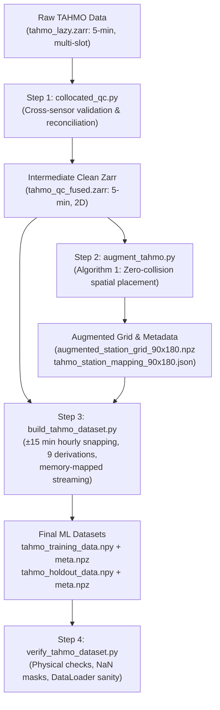

# Rationale: Temporal Resolution, Snapping vs. Averaging, and Collocated QC for ESFM

**Reference Document:** Earth Surface Foundation Model (ESFM) Paper (Ozdemir et al., 2026), Appendix C.3, Table 17, Table 18, and Section 5.3.2.

---

## Summary

This document establishes the rationale and technical specification for:
1. Handling temporal resolution and snapping for 5-minute TAHMO observations in alignment with the **Earth Surface Foundation Model (ESFM)**.
2. Explaining why **temporal averaging/resampling is deliberately avoided** for physical foundation models.
3. Defining the role and execution order of **collocated multi-sensor quality control (QC)**, **spatial grid augmentation (Algorithm 1)**, and **memory-mapped `.npy` tensor construction**.

---

## Temporal Resolution in ESFM: Weather-5K vs. ECMWF 11k

The ESFM architecture evaluates and fine-tunes on two primary observational station benchmarks: **Weather-5K** and **ECMWF 11k**. Their raw temporal properties and pre-processing choices are contrasted below:

| Feature / Property | Weather-5K (Han et al., 2024) | ECMWF 11k (Ozdemir et al., 2026, App. C.3) | TAHMO African Stations (This Pipeline) |
| :--- | :--- | :--- | :--- |
| **Data Source** | NCEI Integrated Surface Database (ISD) | Copernicus CDS `insitu-observations-surface-land` (v2.0.0) | TAHMO Trans-African Hydro-Meteorological Obs (`tahmo_lazy.zarr`) |
| **Spatial Scale** | 5,672 global stations | 11,863 global stations | ~925 African stations (~20,000 collocated sensors) |
| **Temporal Period** | 2014–2023 | 2000–2024 (219,168 hourly steps) | 2015–2026 (multi-year coverage) |
| **Raw Sampling Rate** | Hourly reported synoptic times | Irregular, asynchronous observation times | Native **5-minute** logging intervals |
| **Infilling & Imputation** | Linear interpolation (<12h) + **ERA5 reanalysis infilling** | **Zero interpolation**: Missing values strictly preserved as `NaN` | **Zero interpolation**: Missing values strictly preserved as `NaN` |
| **Completeness Filter** | Stations with $\ge 90\%$ hourly coverage only | Any station with valid observations; $40\%$ threshold only for holdout selection | Uniform holdout sampling ($\ge 40\%$ coverage in holdout year) |
| **Temporal Snapping** | 30-minute replacement window | **$\pm 15$-minute nearest-hour window**; discard outside | **$\pm 15$-minute nearest-hour window**; discard outside |
| **Time-Shift Feature** | Not included | Included: $ts = t_{\text{actual}} - t_{\text{nominal}} \in [-15, +15]$ min | Included: $ts = t_{\text{actual}} - t_{\text{nominal}} \in [-15, +15]$ min |
| **Number of Variables** | 5 ($T, T_d, \text{wd}, \text{ws}, p_{\text{msl}}$) | 9 ($p_a, p_{\text{msl}}, 2t, dt, 10u, 10v, \text{wd}, \text{ws}, ts$) | 9 ($p_a, p_{\text{msl}}, 2t, dt, 10u, 10v, \text{wd}, \text{ws}, ts$) |

---

## Snapping vs. Hourly Averaging

### Why We Do NOT Resample/Average 5-Minute Data to Hourly Means

In standard climatological workflows, sub-hourly data is often averaged to compute hourly means. However, for training ESFM, hourly averaging is counterproductive because:

1. **Destruction of Non-Linear Physical Balances:**
   - **Kinematic Wind Consistency:** Atmospheric dynamics require $ws = \sqrt{u^2 + v^2}$. If scalar wind speed ($ws$) and wind components ($u, v$) are averaged independently over an hour with shifting wind directions, the mean scalar wind speed will exceed $\sqrt{\bar{u}^2 + \bar{v}^2}$ (due to Jensen's inequality and directional cancellation).
   - **Clausius-Clapeyron & Saturation Humidity:** Dew point temperature ($T_d$ or $dt$) is related to temperature ($T$ or $2t$) and relative humidity ($RH$) through the non-linear Magnus-Tetens equation. Averaging temperature and humidity over 60 minutes and computing saturation curves creates thermodynamic states where $dt > 2t$ (physically impossible supersaturation at ground level).

2. **Dampening of Diurnal and Convective Peaks:**
   - Averaging across 60 minutes smears rapid localized phenomena (convective gust fronts, cold pools, intense midday radiative heating spikes, nocturnal boundary layer collapse). Foundation models conditioned on instantaneous ERA5 reanalysis fields ($t$) require ground observations representing instantaneous state snapshots, not smoothed moving averages.

3. **Alignment with ESFM Ground-Truth Definition:**
   - The ESFM paper explicitly states:
     > *"Raw observations are snapped to the nearest UTC hour. Any observation more than 15 minutes from the nominal hour is discarded. When multiple reports fall in the same (hour, station, variable) bin, the one with the smallest temporal offset is retained."* (Ozdemir et al., Appendix C.3)
   - Keeping the station observation free from synthetic temporal smoothing avoids introducing reanalysis-style attenuation or phase lag.

### The Role of the Time Shift Variable ($ts$)

To prevent temporal quantization error caused by snapping asynchronous observations:
- The exact time delta $ts = t_{\text{actual}} - t_{\text{nominal}}$ in minutes (bounded in $[-15, +15]$) is provided as the 9th input channel.
- As demonstrated in ESFM Appendix C.3 and Table 18, $ts$ serves as an explicit data-quality and phase indicator for the transformer's attention mechanisms, allowing the model to internally compensate for sub-hourly timing differences.

---

## What This Means for 5-Minute TAHMO Data

Because TAHMO stations log at a native 5-minute interval (:00, :05, :10, ..., :55), each nominal UTC hour $H:00$ is surrounded by candidates at:
$$\dots, H-15, H-10, H-5, H:00, H+5, H+10, H+15, \dots$$

Under the ESFM snapping framework:
1. **Nominal Hour Selection:**
   - The observation at $H:00$ has offset $\Delta t = 0$. If valid, it is selected with $ts = 0.0$.
2. **Missing/Invalid Fallback:**
   - If the observation at $H:00$ was invalidated during QC (e.g., flatlined, sensor spike, or hardware glitch), the algorithm searches for the observation with minimal $|\Delta t|$ within $[-15, +15]$ min.
   - If $H-5$ or $H+5$ is valid, it is retained with $ts = -5.0$ or $ts = +5.0$.
3. **Out-of-Window Discard:**
   - Observations beyond $\pm 15$ minutes (e.g. at :20, :25, :35, :40) are discarded for nominal hour $H$.
4. **Anchor snapping**
   - Preferred for TAHMO: Selects one time record within $[-15, +15]$ min that maximizes coverage across core variables ($p_a, 2t, dt, ws$), guaranteeing that all 9 derived variables originate from the exact same physical moment and share an exact $ts$.

---

## TAHMO Pre-processing Pipeline Architecture

The pre-processing pipeline consists of:

### Stage Responsibilities:
1. **`collocated_qc.py`:**
   - Ingests raw multi-sensor readings ($K \ge 1$ slots per variable) at native 5-min resolution.
   - Applies physical range gates, flatline detectors, elevation-based pressure plausibility, ultrasonic wind blockage rejection, and peer-consensus adaptive tolerance.
   - Writes `tahmo_qc_fused.zarr` containing 2D `(time, station)` cleaned primitives and retains station `lat`, `lon`, and `elevation` coordinates.
2. **`augment_tahmo.py`:**
   - Ingests station coordinates from `tahmo_qc_fused.zarr`.
   - Filters out non-African test stations (bounding box lat $[-36, 38]$, lon $[-20, 55]$).
   - Combines 11,863 global stations with TAHMO stations and runs SwissClim Algorithm 1 greedy placement to produce zero-collision grid coordinates on the $(90, 180)$ canvas.
3. **`build_tahmo_dataset.py`:**
   - Streams clean blocks from `tahmo_qc_fused.zarr`.
   - Derives the 9 ESFM targets (`pa, msl, 2t, dt, 10u, 10v, wd, ws, ts`).
   - Executes the $\pm 15$-minute nearest-hour snapping rule.
   - Maps stations to their $(row, col)$ grid cells in the $(T, 9, 90, 180)$ canvas.
   - Writes memory-mapped `.npy` files and `.npz` companion metadata containing normalization parameters.
4. **`verify_tahmo_dataset.py`:**
   - Validates memory layout, strict NaN background masking on non-station cells, physical range distributions, and metadata integrity.

